# Python + Temporal: O Core de Workflows Modernos

[](https://github.com/AdilsonTorres/python-temporal-core/actions/workflows/ci.yml)   

Exemplos da palestra da **Python Brasil 2026** (Adilson Torres): workflows duráveis em Python, pequenos o bastante para ler em uma tela.

Página da palestra: https://talks.python.org.br/pybr26/talk/USZCFC/

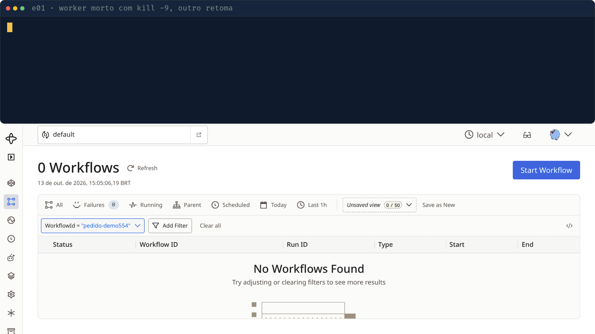

## Quickstart

Requisitos: [uv](https://docs.astral.sh/uv/) e `make` (ou só Docker). O `uv sync` instala o Python 3.14 e as dependências.

```bash
make setup        # 1. instala as dependências
make servidor     # 2. terminal 1: servidor Temporal local (UI em http://localhost:8233, Ctrl+C para sair)
make ui           #    opcional, com Docker: UI 2.56 em http://localhost:8080
make e01-worker   # 3. terminal 2: worker do pedido
make e01          #    terminal 3: inicia um pedido (depois veja o workflow na UI)
```

Só Docker, sem instalar nada:

```bash
make docker-build && make docker-up   # servidor Temporal em container
make docker-e01                       # worker e01 + inicia um pedido
```

`make` sem argumentos lista todos os alvos. Mais detalhes na seção [Docker](#docker).

## Como funciona

O servidor guarda o histórico de eventos de cada workflow. Os workers (seu código Python) buscam tarefas nas filas, executam e devolvem o resultado.

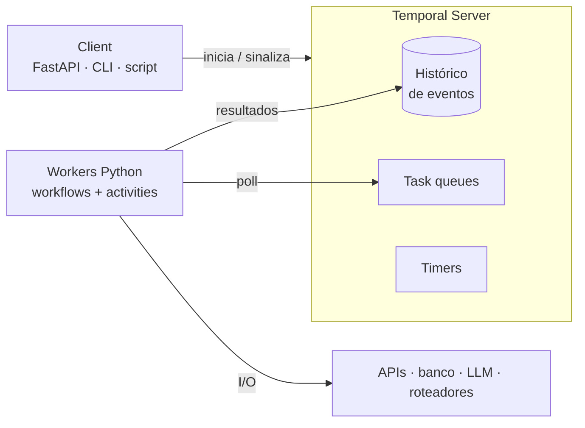

Se o worker morre, outro assume: ele refaz o **replay** do histórico, pula o que já foi feito e continua do passo interrompido.

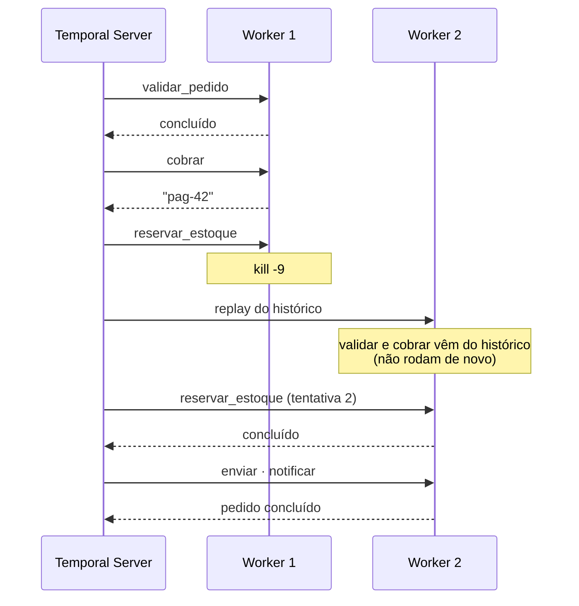

## Exemplos

Cada diretório de `src/exemplos/` é um padrão. Abra a UI em http://localhost:8233 enquanto roda.

| # | Padrão | Comandos make | O que observar |
|---|---|---|---|
| [e00](src/exemplos/e00_problema/README.md) | O "antes": retry/sleep/status na mão | `python -m exemplos.e00_problema.fragil` | Tudo que o código trata na mão e ainda perde se o processo morrer |
| [e01](src/exemplos/e01_pedido/README.md) | Workflow + activities, durabilidade | `e01-worker` · `e01` · `e01-falha` | `kill -9` no worker: o pedido continua do passo onde parou |
| [e02](src/exemplos/e02_idempotencia/README.md) | Workflow ID como chave de idempotência | `e02-worker` · `e02-api` · `e02` | O mesmo evento 3 vezes cria 1 workflow |
| [e03](src/exemplos/e03_saga/README.md) | SAGA com compensação | `e03-worker` · `e03` · `e03-falha` | Compensações em ordem reversa, como activities no histórico |
| [e04](src/exemplos/e04_aprovacao/README.md) | Human-in-the-loop: Update, Signal, Query, timer | `e04-worker` · `e04-pedir` · `e04-status` · `e04-aprovar` | Auto-aprovação rejeitada pelo validador (nem entra no histórico) |
| [e05](src/exemplos/e05_agendamentos/README.md) | Timers duráveis e Schedules | `e05-worker` · `e05-agendar` · `e05` | Schedule na UI: pausar, retomar, histórico |
| [e06](src/exemplos/e06_agente/README.md) | Agente de IA durável (Pydantic AI) | `e06-worker` · `e06` · `e06-aprovar` | Cada chamada ao LLM e cada tool é uma activity; o agente não aprova a si mesmo |
| [e07](src/exemplos/e07_fila_gpu/README.md) | Fila de inferência com backend instável (extra) | `e07-backend` · `e07-worker` · `e07` | Backend fora do ar: retries na UI, tudo termina quando volta |
| [e08](src/exemplos/e08_versionamento/README.md) | Versionamento com `workflow.patched` (extra) | `e08-worker-v1` · `e08-worker-v2` · `e08` | Troca de versão com workflow em andamento, sem quebrar o replay |
| [e09](src/exemplos/e09_benchmark_python/README.md) | Fan-out de benchmarks (extra) | `e09-worker` · `e09` | Uma activity por medição, 1 por vez; resumo por versão do Python |

### Extras (branch extras)

| Exemplo | Tema | Comandos | O que mostra |
|---|---|---|---|
| [e10](src/exemplos/e10_automacao_rede/README.md) | Automação de rede com rollback | `e10-worker` · `e10` · `e10-falha` · `e10-api` | Saga: verificação falha e a config é revertida; webhook idempotente |
| [e11](src/exemplos/e11_lembrete_soneca/README.md) | Lembrete com soneca | `e11-worker` · `e11` | Timer cancelável, Signals e `continue_as_new` |
| [e12](src/exemplos/e12_fanout_child/README.md) | Fan-out com child workflows | `e12-worker` · `e12` | 10 filhos em lotes de 3, Query de progresso |
| [e13](src/exemplos/e13_canario_worker/README.md) | Canário de workers | `e13-worker` · `e13` · `e13-agendar` | Alerta quando uma task queue fica sem poller |
| [e14](src/exemplos/e14_entidade_carrinho/README.md) | Entidade: carrinho | `e14-worker` · `e14` | Updates com validador e workflow vivo por entidade |

Cada comando abaixo roda em um terminal, com o servidor (`make servidor`) já de pé.

### e00: o problema

```bash
uv run python -m exemplos.e00_problema.fragil
```

Código de contraste: leia, não use. É o que os exemplos seguintes substituem.

### e01: pedido que sobrevive a kill -9

```bash
make e01-worker              # terminal 1 (imprime o pid)
make e01 PEDIDO=demo1        # terminal 2
kill -9 <pid do worker>      # quando aparecer ">>> enviar"
make e01-worker              # terminal 1 de novo
```

O novo worker reexecuta só o passo interrompido (`tentativa 2`); `validar_pedido` e `cobrar` não rodam de novo. Use um `PEDIDO` novo a cada ensaio (o padrão é `42`). `make e01-falha` sobe o worker com `cobrar` falhando nas 2 primeiras tentativas: o retry é automático.

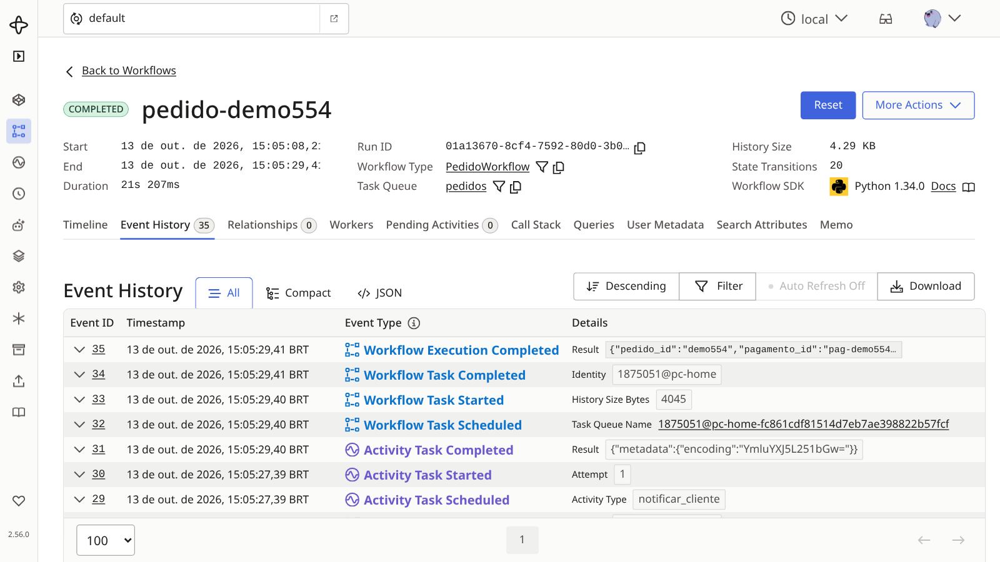

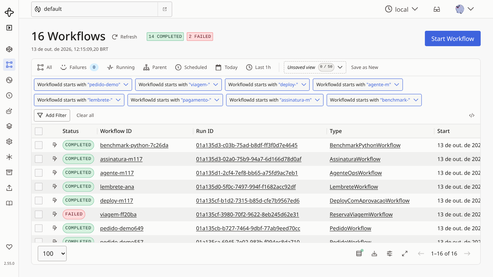


### e02: idempotência

```bash
make e02-worker
make e02-api         # FastAPI na porta 8000
make e02             # envia o mesmo evento 3 vezes
```

Na UI: um único workflow, com ID derivado do `evento_id`. Via HTTP: `curl -X POST localhost:8000/webhooks/pagamento -H 'content-type: application/json' -d '{"evento_id": "evt_123", "pedido_id": "42", "valor": 350}'` (repita).

### e03: SAGA

```bash
make e03-worker
make e03             # caminho feliz
make e03-falha       # o carro falha: hotel e voo são cancelados, nessa ordem
```

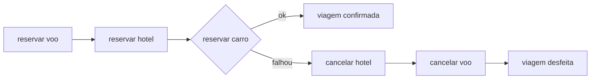

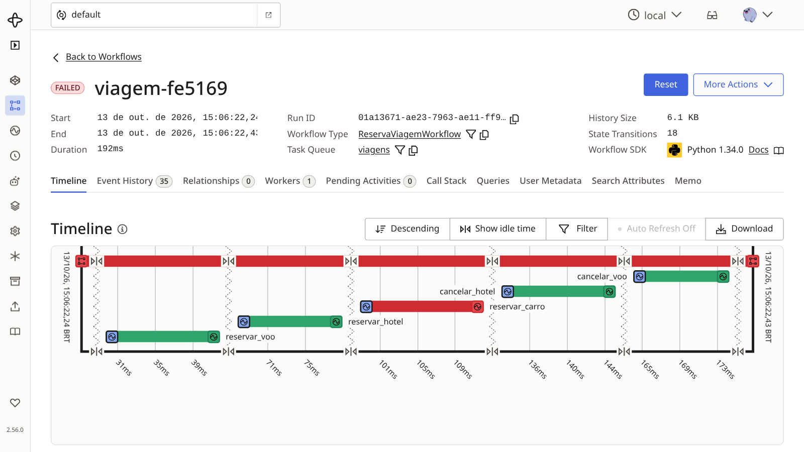

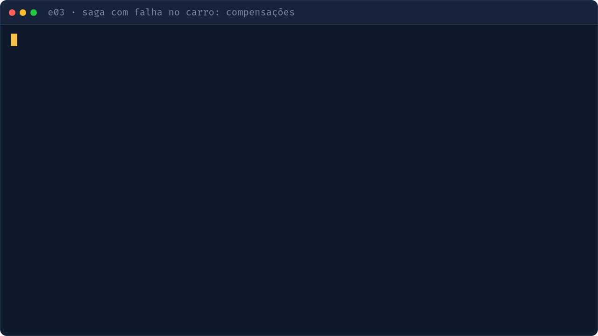

### e04: aprovação humana

```bash
make e04-worker
make e04-pedir ID=deploy-1
make e04-status ID=deploy-1
make e04-aprovar ID=deploy-1 QUEM=ana     # rejeitado: quem pediu não aprova
make e04-aprovar ID=deploy-1 QUEM=bruno   # ok
```

O workflow espera em `wait_condition` (timer de 3 dias para rejeitar sozinho). O Update inválido é barrado pelo validador e não entra no histórico. Para rejeitar por Signal: `uv run python -m exemplos.e04_aprovacao.cli rejeitar deploy-1 bruno`.

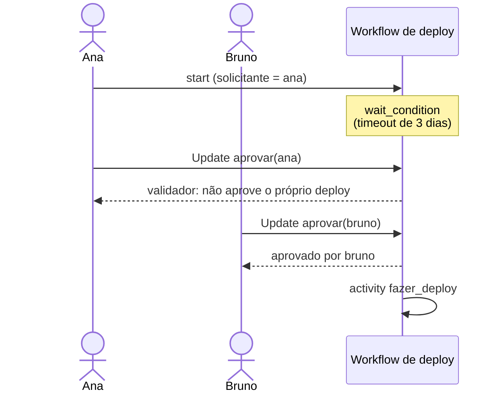


### e05: timers e Schedules

```bash
make e05-worker
make e05-agendar     # cria/atualiza o Schedule "relatorio-diario" (seg a sex, 08:00)
make e05             # lembrete que dorme 20 s (timer durável)
```

Na UI: aba Schedules (pausar, retomar, disparar) e o timer do lembrete. Para encerrar o sleep antes (requer o [CLI do Temporal](https://docs.temporal.io/cli)): `temporal workflow signal --workflow-id lembrete-ana --name concluir`.

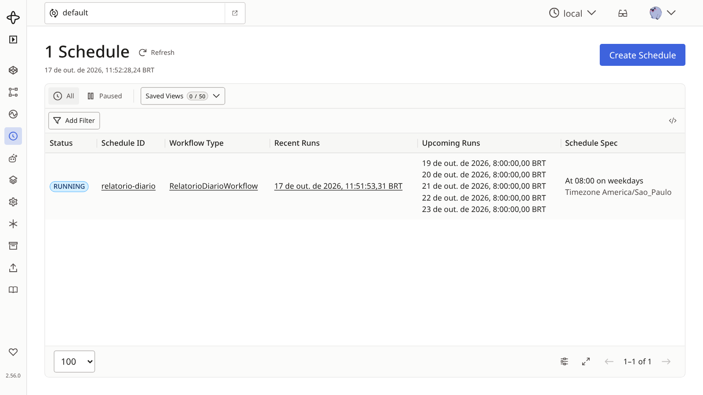

### e06: agente de IA durável

```bash
make e06-worker
make e06                              # AGENTE=agente-1: pede ao agente
make e06-aprovar QUEM=bruno           # aprova a ação perigosa pendente
```

Por padrão usa um LLM falso roteirizado (offline, sem chave). O agente quer reiniciar um serviço e para esperando aprovação; `QUEM=agente_ops` é rejeitado. Alternativa: `uv run python -m exemplos.e06_agente.iniciar` gera um ID novo e imprime o comando de aprovação (`... iniciar mcp` usa tools via servidor MCP).

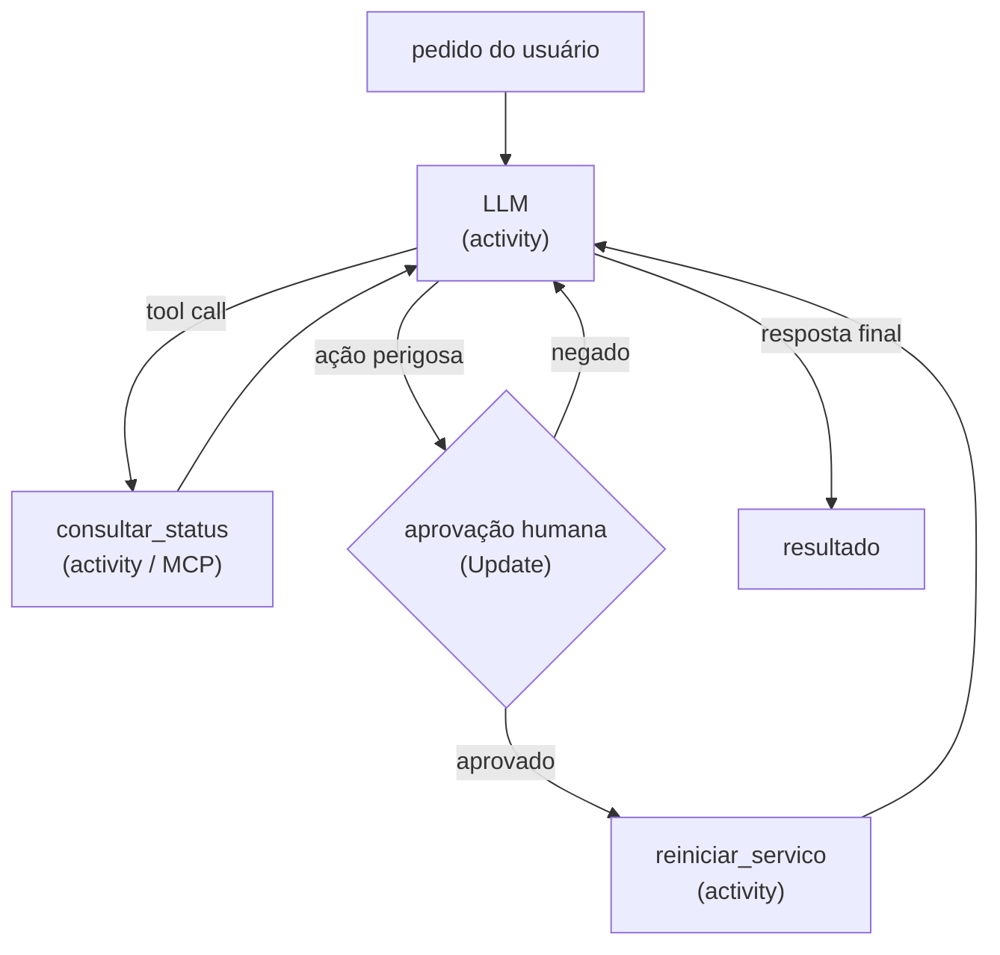

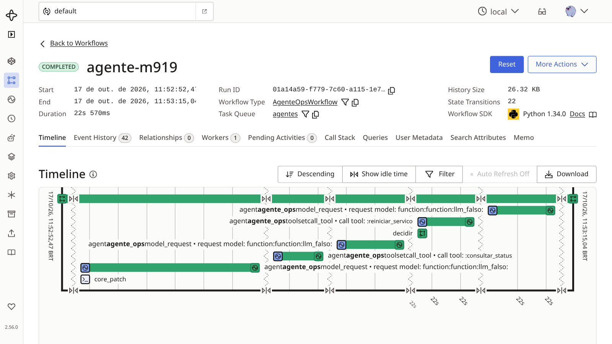


### e07: fila de GPU (extra)

```bash
make e07-backend     # terminal 1: backend falso (formato Ollama, porta 8001)
make e07-worker      # terminal 2: max_concurrent_activities=1
make e07             # terminal 3: dispara vários prompts
```

Com os prompts em andamento, Ctrl+C no backend: as activities entram em retry com backoff e os workflows continuam Running. Suba o backend de novo e tudo termina, um por vez.

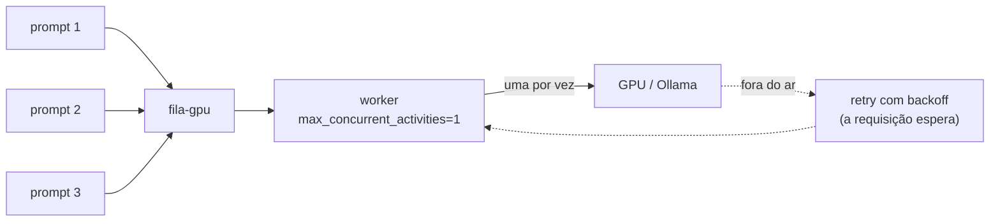

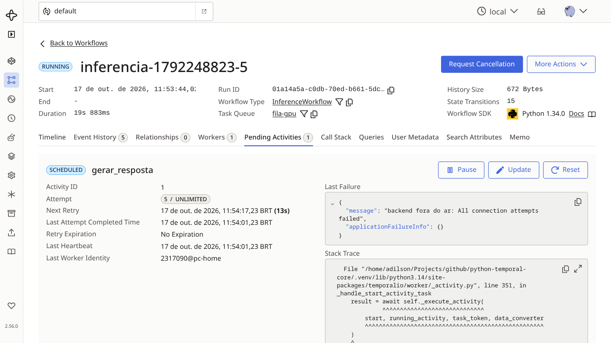

### e08: versionamento (extra)

```bash
make e08-worker-v1   # terminal 1
make e08             # inicia o workflow na v1 (dorme 20 s; ESPERA=15 muda)
# Ctrl+C no worker v1, depois:
make e08-worker-v2   # a v2 usa workflow.patched: o antigo segue v1, o novo segue v2
```

`v2_quebrado.py` é a mesma mudança sem `patched`: quebra o replay (coberto nos testes).

### e09: benchmark entre versões do Python (extra)

```bash
make e09-worker
make e09             # 10 rodadas × 3 repetições (mediana); a 1ª execução baixa os interpretadores via uv
```

Uma activity por medição, concorrência 1 para não distorcer. Opções: `uv run python -m exemplos.e09_benchmark_python.iniciar --repeticoes 1 --free-threaded`. Progresso (requer o CLI do Temporal): `temporal workflow query --workflow-id <id> --name progresso`.

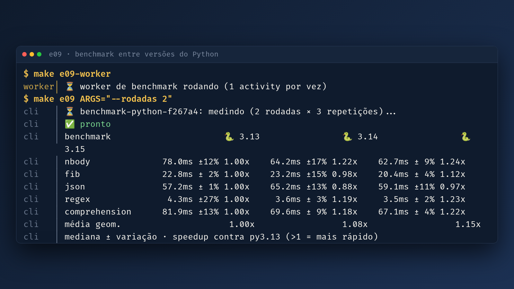

Para popular a UI de uma vez (com o servidor já no ar): `make todos` (o benchmark e09 só entra com `TODOS_COM_BENCHMARK=1`).

## Variáveis de ambiente

| Variável | Padrão | Efeito |
|---|---|---|
| `TEMPORAL_ADDRESS` | `127.0.0.1:7233` | Endereço do servidor |
| `TEMPORAL_NAMESPACE` | `default` | Namespace |
| `DEMORA_PASSO` | `3` | e01: segundos por passo (tempo para matar o worker) |
| `FALHAR_PAGAMENTO` | desligado | e01: `cobrar` falha nas 2 primeiras tentativas (`make e01-falha`) |
| `FALHAR_CARRO` | desligado | e03: mesmo efeito de `make e03-falha` (vale no worker) |
| `AGENTE_MODELO` | LLM falso | e06: modelo real, ex. `ollama:qwen3:8b` ou `openai:...` (com `OPENAI_API_KEY`) |
| `AGENTE_FALHAS_LLM` | `0` | e06: falhas simuladas do LLM antes de responder |
| `LLM_BACKEND_URL` | `http://localhost:8001` | e07: backend de LLM |

## Testes

```bash
make test    # uv run pytest
make lint    # ruff check + ruff format --check
```

Os testes usam o servidor **time-skipping** do SDK: não precisam de servidor externo e pulam os timers (o timer de 3 dias do e04 roda em milissegundos). O **replay** também é testado (e01 e e08): um histórico gravado precisa reproduzir com o código novo, e quebra sem o `patched`.

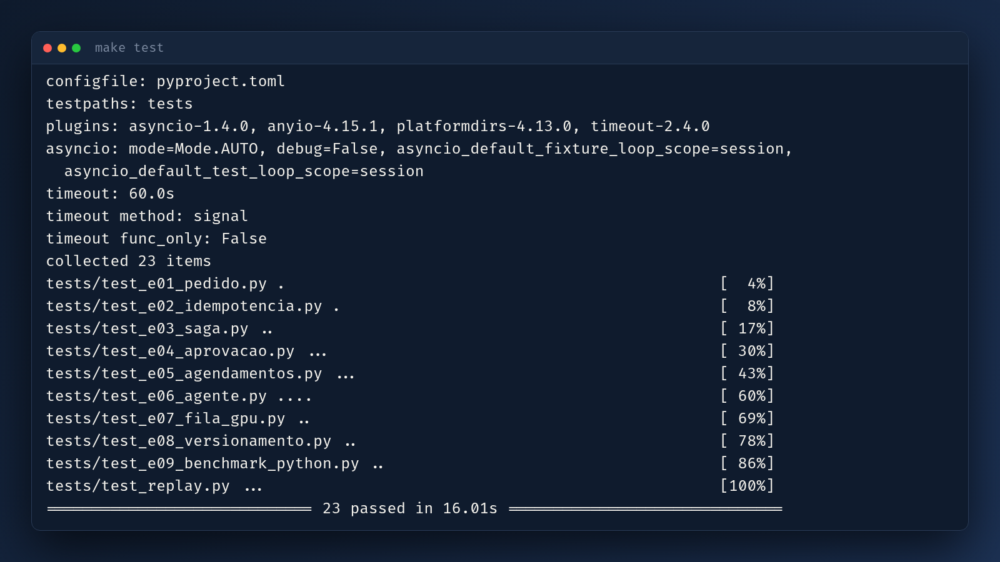

## Docker

Nada instalado além do Docker. O `compose.yaml` tem o serviço `temporal` (sempre) e um *profile* por exemplo: `e01` ... `e08` (workers e APIs) e `tools` (container avulso `app` para rodar os clients).

```bash
make docker-build    # constrói a imagem
make docker-up       # servidor + UI 2.56 (http://localhost:8233)
make docker-e01      # worker e01 + inicia um pedido
make docker-down     # derruba tudo
```

Demo do kill em Docker:

```bash
make docker-kill-e01                          # kill -9 no container do worker
docker compose --profile e01 up -d e01-worker # religa: o pedido continua
```

Outros exemplos: `docker compose --profile e03 up -d` sobe o worker; o client roda com `docker compose --profile tools run --rm app python -m exemplos.e03_saga.iniciar`.

Portas ocupadas? `TEMPORAL_PORTA=17233 TEMPORAL_UI_PORTA=18233 make docker-up` (padrões 7233 e 8233).

## Para ir além

- Documentação do SDK Python: https://docs.temporal.io/develop/python
- SDK no GitHub: https://github.com/temporalio/sdk-python
- Pydantic AI + Temporal (execução durável): https://pydantic.dev/docs/ai/integrations/durable_execution/temporal/
- Roteiro das demos ao vivo: [docs/roteiro-demo.md](docs/roteiro-demo.md)

## Licença

MIT. Veja [LICENSE](LICENSE).

## Palestras anteriores

- [event-driven-automation](https://github.com/wsdoprado/event-driven-automation): Semana de Capacitação 11, NIC.br, 2025 (com William Prado).
- [enfrentando-o-temporal](https://github.com/AdilsonTorres/enfrentando-o-temporal): Semana de Capacitação 12, 2026.
