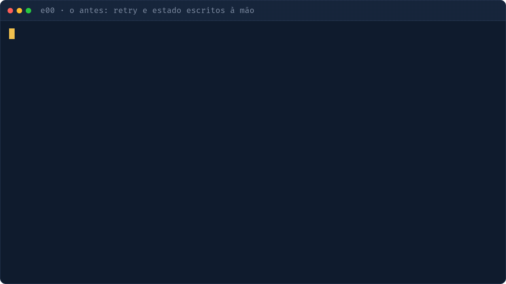

# e00 — O problema: o "antes" sem Temporal

## Objetivo
Mostrar tudo que o código faz na mão (retry, `sleep`, status salvo) e que ainda se perde se o processo morrer. É a motivação para os exemplos seguintes.

| Conceito | Onde ver |
|---|---|
| Retry com backoff manual | `fragil.py` · `com_retry` |
| Estado do passo salvo na mão | `fragil.py` · `salvar_passo` |
| Fluxo que não sobrevive a crash | `fragil.py` · `processar_pedido` |

## Como executar
```bash
uv run python -m exemplos.e00_problema.fragil   # não precisa de servidor
```
O estado fica em `pedidos.db`: numa 2ª execução o pedido já está concluído e nada roda. Apague o arquivo para repetir.

## O que observar
- O `time.sleep` do retry: se o processo morrer ali, a tentativa e o contexto somem.
- `salvar_passo` é o "banco" improvisado; compare com o histórico durável do e01.
- Quanto código de infraestrutura entra antes de qualquer regra de negócio.


