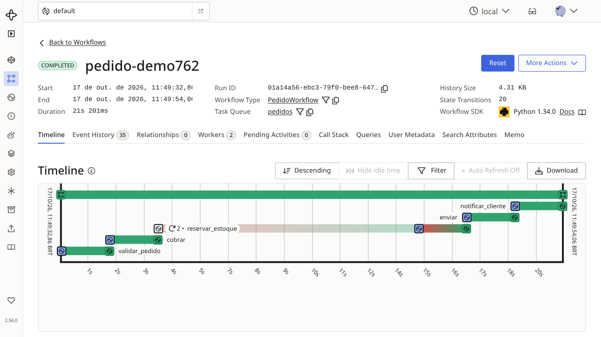
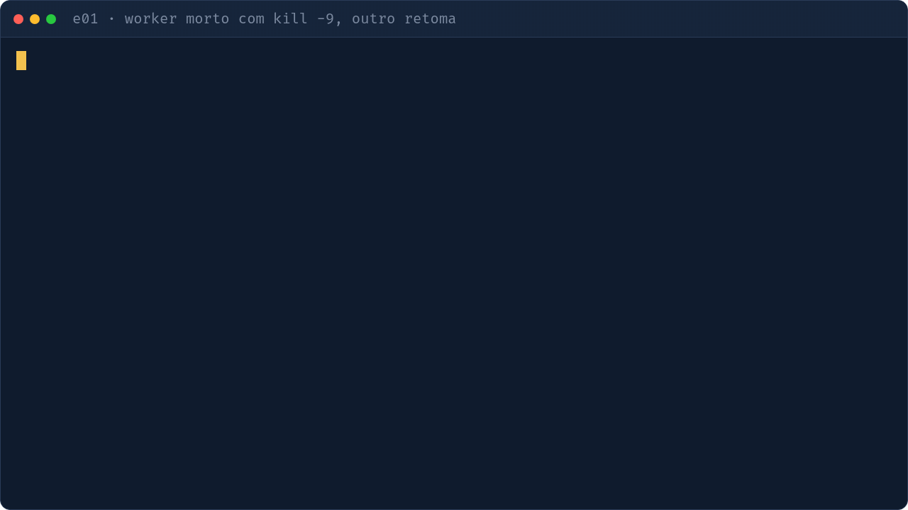

# e01 — Pedido que sobrevive a kill -9

## Objetivo
Workflow com 5 activities (validar, cobrar, reservar, enviar, notificar). Mate o worker no meio: o pedido continua do passo onde parou.

| Conceito | Onde ver |
|---|---|
| Workflow = caminho feliz em Python comum | `workflows.py` · `PedidoWorkflow.run` |
| Activities e `RetryPolicy` (erro de negócio não repete) | `workflows.py` · `RETRY`; `activities.py` |
| Query de status | `workflows.py` · `status` |
| Modelos Pydantic | `modelos.py` |

## Como executar
```bash
make servidor                # terminal 1 (UI http://localhost:8233)
make e01-worker              # terminal 2 (imprime o pid)
make e01 PEDIDO=demo1        # terminal 3
kill -9 <pid>                # com o pedido em andamento; depois: make e01-worker
```
`make e01-falha` sobe o worker com `cobrar` falhando nas 2 primeiras tentativas. `DEMORA_PASSO=1` encurta a pausa por passo (mantenha abaixo de 10 s, o timeout de cada activity). Depois de um `kill -9`, o passo interrompido é retomado em até ~10 s.

## O que observar
- Terminal: o novo worker mostra `tentativa 2` só do passo interrompido; os anteriores não rodam de novo.
- UI: workflow `pedido-demo1`, aba History com `ActivityTaskScheduled/Completed` por passo.
- Com `e01-falha`: `ActivityTaskFailed` e tentativas crescendo (backoff) até dar certo.



