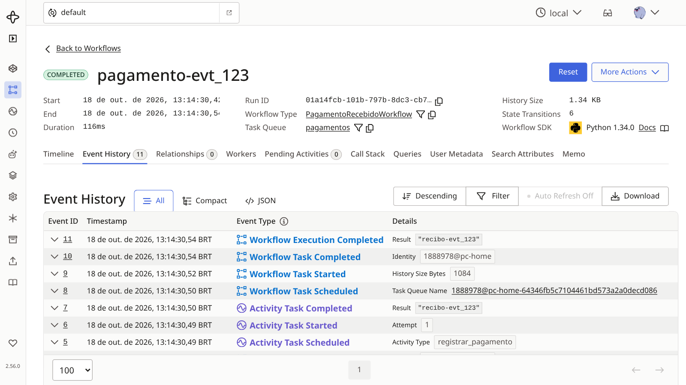
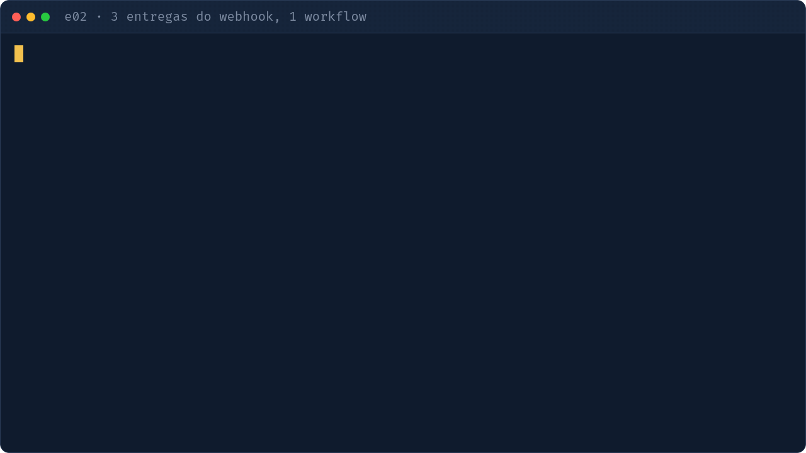

# e02 — Idempotência com Workflow ID

## Objetivo
Um webhook que entrega o mesmo evento várias vezes cria só um workflow: o ID do workflow é a chave de idempotência.

| Conceito | Onde ver |
|---|---|
| ID determinístico a partir do evento | `api.py` · `iniciar_pagamento` |
| `WorkflowIDConflictPolicy.USE_EXISTING` / `REJECT_DUPLICATE` | `api.py` |
| Endpoint FastAPI | `api.py` · `webhook_pagamento` |
| Workflow e activity do pagamento | `workflows.py` |

## Como executar
```bash
make servidor        # terminal 1
make e02-worker      # terminal 2
make e02-api         # terminal 3 (opcional: FastAPI na porta 8000)
make e02             # terminal 4: envia o mesmo evento 3 vezes
```

## O que observar
- Terminal: 3 entregas, todas com o mesmo `workflow_id` (`3 entregas, 1 workflow`).
- UI: um único workflow para o evento, com uma só execução da activity.
- Pelo webhook, reenvie o mesmo JSON: a resposta continua apontando para o mesmo ID.



