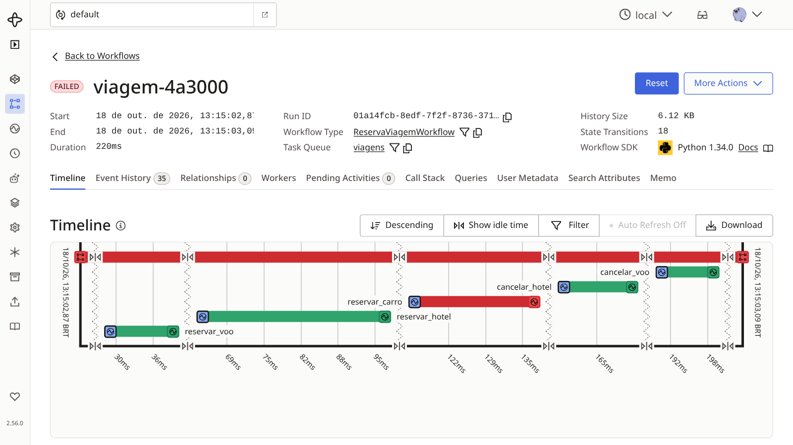
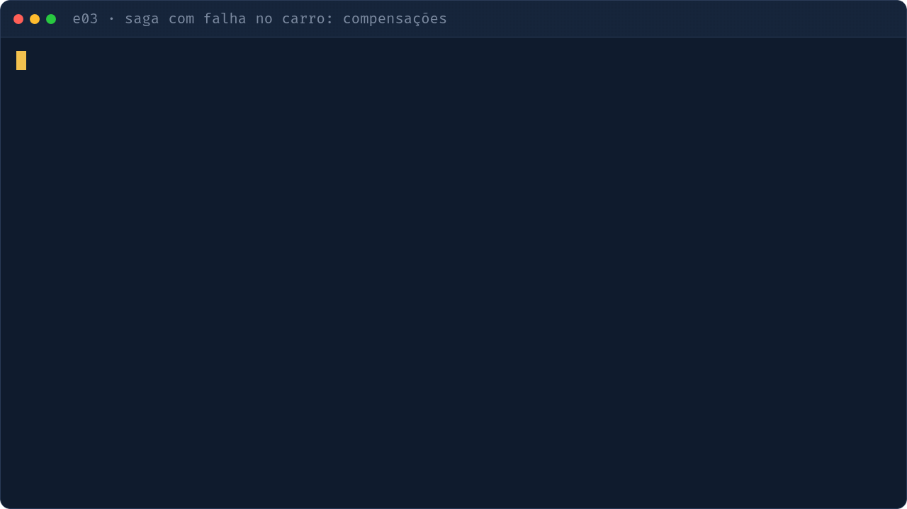

# e03 — SAGA com compensação

## Objetivo
Reservar voo, hotel e carro. Se o carro falhar, as reservas anteriores são desfeitas em ordem reversa, sem `try/except` espalhado.

| Conceito | Onde ver |
|---|---|
| Lista de compensações (LIFO) | `workflows.py` · `ReservaViagemWorkflow.run` |
| Compensações como activities | `activities.py` · `cancelar_*` |
| Falha injetada | `activities.py` (`falhar_carro` / `FALHAR_CARRO`) |
| Falha do workflow tratada no cliente | `iniciar.py` |

## Como executar
```bash
make servidor        # terminal 1
make e03-worker      # terminal 2
make e03             # terminal 3: caminho feliz
make e03-falha       # terminal 3: o carro falha, hotel e voo são cancelados
```

## O que observar
- Terminal do worker: `cancelar_hotel` antes de `cancelar_voo` (ordem reversa).
- UI: no workflow de falha, as compensações aparecem como activities no histórico.
- O workflow termina como `Failed`, mas com o estado consistente.



