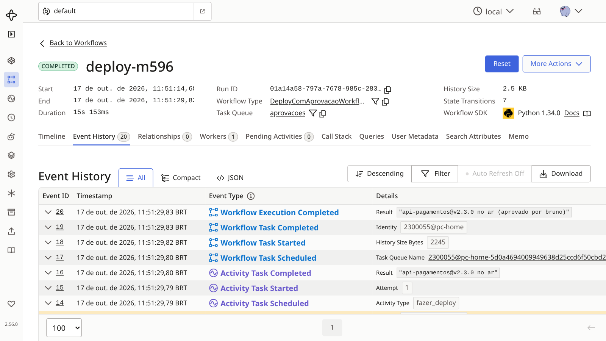
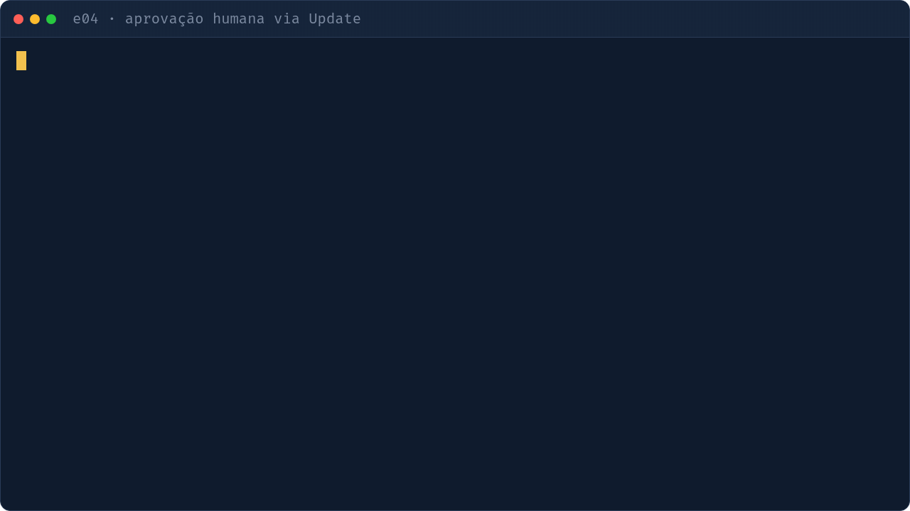

# e04 — Aprovação humana (Update, Signal, Query, timer)

## Objetivo
Um deploy espera aprovação de outra pessoa. O workflow fica parado em `wait_condition` (com timer de 3 dias) até alguém decidir.

| Conceito | Onde ver |
|---|---|
| Espera durável + timeout | `workflows.py` · `wait_condition` em `run` |
| Update com validador (barra auto-aprovação) | `workflows.py` · `aprovar` / `@aprovar.validator` |
| Signal (rejeitar) e Query (status) | `workflows.py` · `rejeitar`, `status` |
| Update-with-Start: inicia e já recebe o estado numa chamada | `cli.py` · `pedir` (`execute_update_with_start_workflow`) |
| Estado inicial antes de qualquer Update | `workflows.py` · `@workflow.init` |
| Não encerra com handler em andamento | `workflows.py` · `wait_condition(workflow.all_handlers_finished)` |
| CLI de interação | `cli.py` |

## Como executar
```bash
make servidor                                # terminal 1
make e04-worker                              # terminal 2
make e04-pedir ID=deploy-1                   # terminal 3 (ana pede)
make e04-status ID=deploy-1
make e04-aprovar ID=deploy-1 QUEM=ana        # rejeitado: quem pediu não aprova
make e04-aprovar ID=deploy-1 QUEM=bruno      # ok
```

## O que observar
- Terminal: `❌ update rejeitado` para a ana; `✅` para o bruno.
- `make e04-pedir` duas vezes com o mesmo ID: o segundo reaproveita o workflow (`USE_EXISTING`) e só devolve o estado.
- UI: o Update inválido não entra no histórico; o válido aparece como `WorkflowExecutionUpdateAccepted/Completed`.
- Enquanto espera, o workflow está `Running` sem consumir worker.



