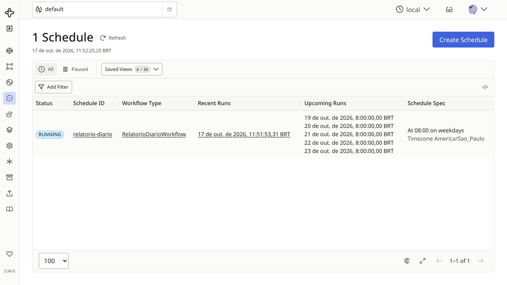
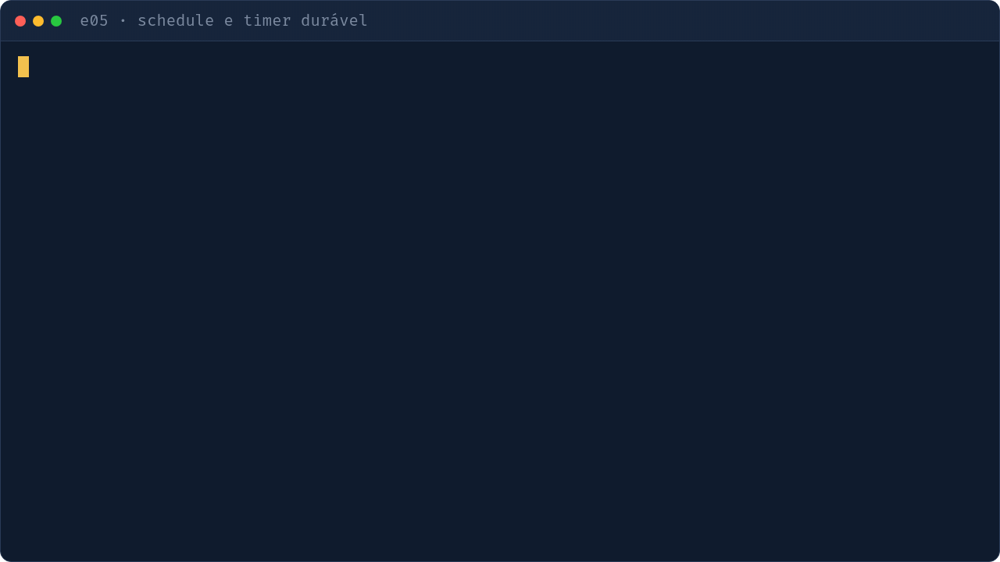

# e05 — Timers duráveis e Schedules

## Objetivo
`workflow.sleep` de segundos ou dias vira timer no servidor, não segura processo. Schedules substituem o crontab.

| Conceito | Onde ver |
|---|---|
| Lembrete com timer e Signal | `workflows.py` · `LembreteWorkflow` |
| Timer longo (7 dias) | `workflows.py` · `BoasVindasWorkflow` (roda em ms no teste: `uv run pytest tests/test_e05_agendamentos.py`) |
| Workflow disparado por Schedule | `workflows.py` · `RelatorioDiarioWorkflow` |
| Criar/atualizar Schedule (cron seg-sex 08:00) | `agendar.py` |
| Alternativas de `ScheduleSpec` (cron, intervalo, calendário, fuso, jitter) e política de overlap/catchup | comentário em `agendar.py` |

## Como executar
```bash
make servidor        # terminal 1
make e05-worker      # terminal 2
make e05-agendar     # terminal 3: cria o Schedule "relatorio-diario" e dispara uma vez
make e05             # lembrete que dorme 20 s
```
Opcional: `uv run python -m exemplos.e05_agendamentos.iniciar 5` (5 s).

## O que observar
- Terminal: `⏳ lembrete em 20s` e depois `🔔` quando o timer vence.
- UI, aba Schedules: `relatorio-diario`, próxima execução, pausar e retomar.
- UI, histórico do lembrete: `TimerStarted` / `TimerFired`.



