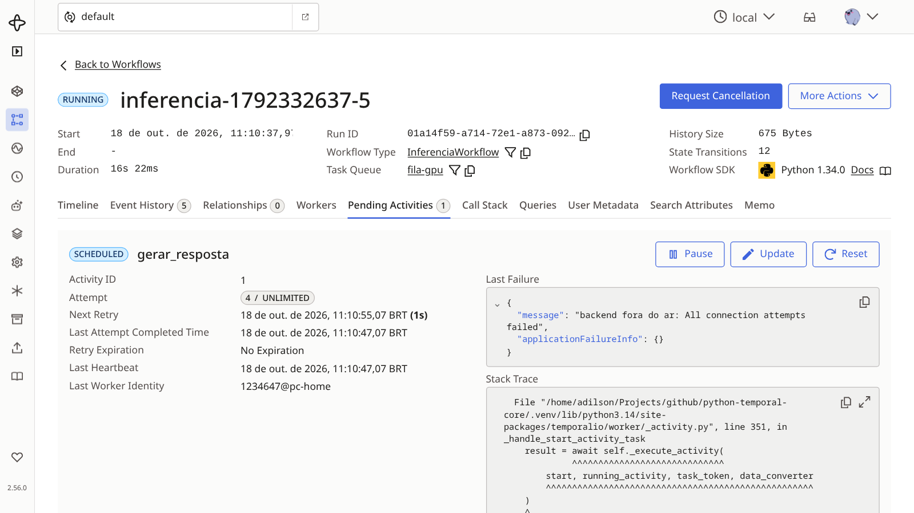
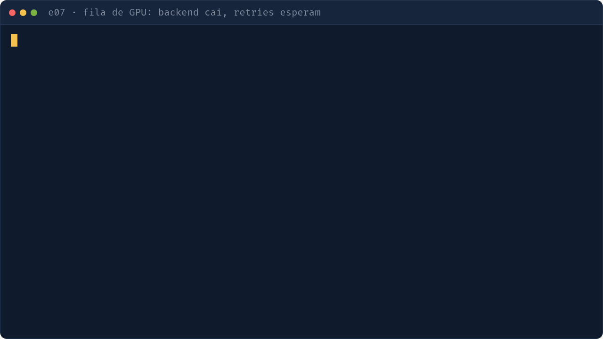

# e07 — Fila de inferência com backend instável (extra)

## Objetivo
Vários prompts entram numa fila e o worker atende um por vez (GPU). Se o backend de LLM cair, as activities repetem e tudo termina quando ele volta.

| Conceito | Onde ver |
|---|---|
| Concorrência limitada (1 por vez) | `worker.py` · `max_concurrent_activities` |
| Retry e heartbeat em activity longa | `workflows.py` (`RetryPolicy`); `activities.py` · `gerar_resposta` |
| Backend falso (formato Ollama, 2 s/resposta) | `backend_falso.py` |

## Como executar
```bash
make servidor        # terminal 1
make e07-backend     # terminal 2 (porta 8001)
make e07-worker      # terminal 3
make e07             # terminal 4: 5 prompts (uv run python -m exemplos.e07_fila_gpu.iniciar 3 para 3)
```
Derrube o backend (Ctrl+C) no meio e suba de novo.

## O que observar
- Terminal: respostas saindo uma a uma.
- Com o backend fora: erros de conexão e novas tentativas, sem perder prompt.
- UI: `ActivityTaskFailed`/tentativas crescentes; ao voltar, todos os workflows completam.



