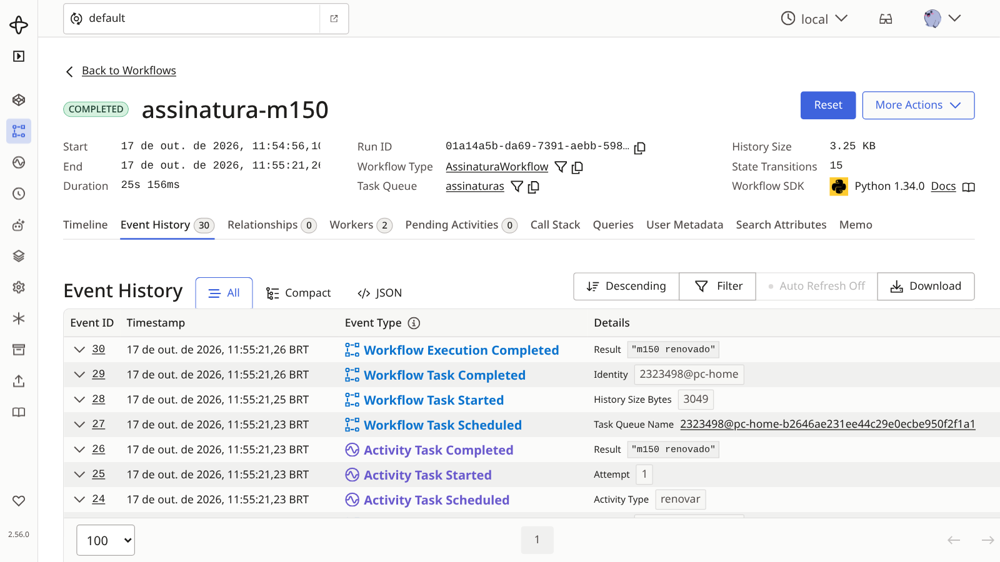
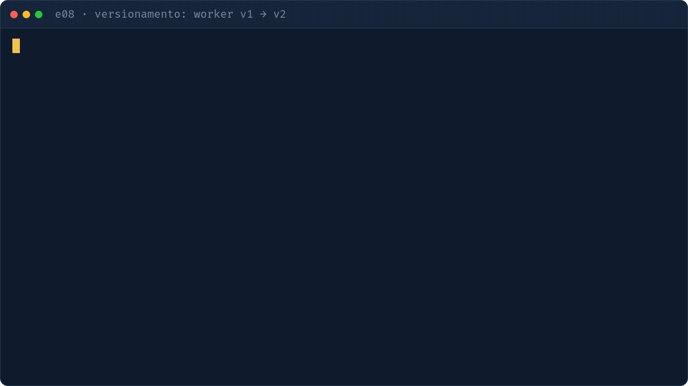

# e08 — Versionamento com `workflow.patched` (extra)

## Objetivo
Mudar o código de um workflow em andamento sem quebrá-lo: a execução antiga segue o caminho v1, as novas seguem a v2 (com lembrete antes de renovar).

| Conceito | Onde ver |
|---|---|
| Workflow original | `v1.py` |
| Mudança protegida por patch | `v2.py` · `workflow.patched("lembrete-antes-de-renovar")` |
| Mudança sem patch (não determinismo) | `v2_quebrado.py` |
| Escolha da versão no worker | `worker.py` (`v1` \| `v2`) |
| Gate de deploy com replay | `gravar_historico.py`; `make replay` |

> **patched ou Worker Versioning?** `workflow.patched` serve para uma mudança pontual num workflow em andamento (como aqui).
> Para deploys de produção, a documentação recomenda o [Worker Versioning](https://docs.temporal.io/production-deployment/worker-deployments/worker-versioning)
> (Pinned / Auto-Upgrade), com o worker de cada versão rodando até as execuções antigas terminarem.
> Os dois se combinam com o gate de replay no CI.

## Como executar
```bash
make servidor            # terminal 1
make e08-worker-v1       # terminal 2
make e08                 # terminal 3: inicia o workflow e dorme 20 s (ESPERA=15 muda)
# Ctrl+C no worker v1, depois:
make e08-worker-v2       # terminal 2
uv run python -m exemplos.e08_versionamento.gravar_historico assinatura-ana   # grava tests/historicos/assinatura_gravada.json (o make replay testa todos)
make replay              # replay dos históricos gravados
```

## O que observar
- Terminal: a v2 retoma o workflow que dormia sem quebrar o replay; como ele ainda não passou do ponto do patch, também envia o lembrete.
- UI: o marker de patch aparece nessas execuções; um workflow já além do ponto (renovar agendada) seguiria o caminho v1, sem lembrete.
- Com `v2_quebrado`, o replay falha: é o que o gate pega antes do deploy.



