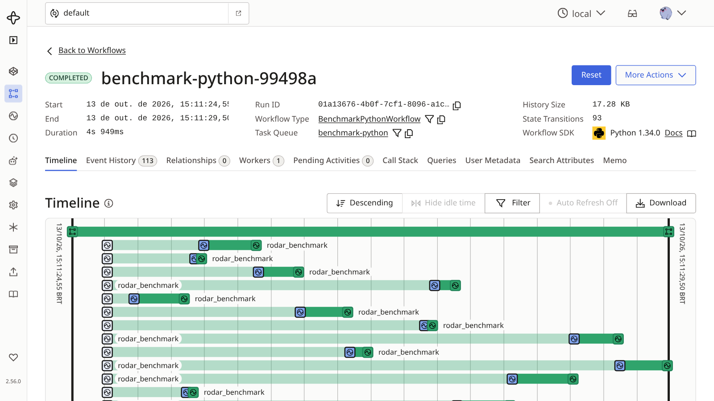
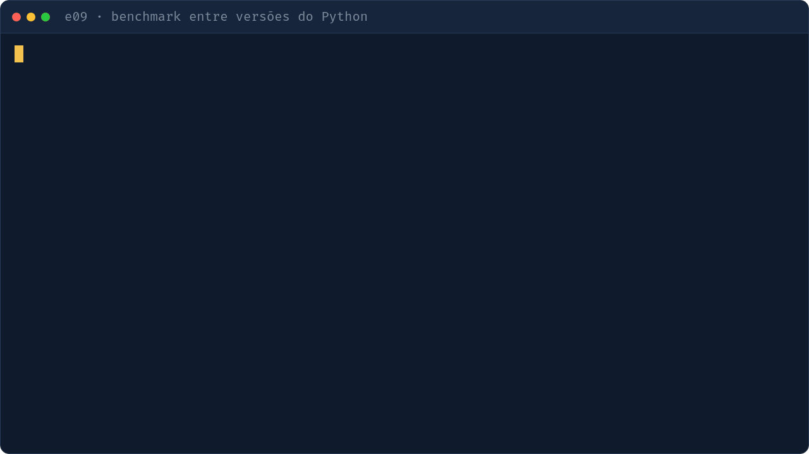

# e09 — Benchmark entre versões do Python (extra)

## Objetivo
Fan-out de medições: uma activity por (versão do Python, benchmark), uma por vez para não distorcer, com resumo de speedup por versão.

| Conceito | Onde ver |
|---|---|
| Orquestração das medições + Query de progresso | `workflows.py` · `BenchmarkPythonWorkflow` |
| Concorrência 1 | `worker.py` · `max_concurrent_activities=1` |
| Instala Pythons via `uv` e mede em subprocesso | `activities.py` |
| Tabela de resultado | `iniciar.py` · `tabela` |

## Como executar
```bash
make servidor        # terminal 1
make e09-worker      # terminal 2
make e09             # terminal 3 (5 repetições)
uv run python -m exemplos.e09_benchmark_python.iniciar --repeticoes 1 --free-threaded
```
Requer `uv` com acesso à rede: a 1ª execução baixa os interpretadores (demora).

## O que observar
- Terminal: tabela com ms e speedup por versão, contra a base.
- UI: dezenas de activities em sequência, nunca em paralelo.
- Progresso (requer o CLI do Temporal): `temporal workflow query --workflow-id <id> --name progresso`.



